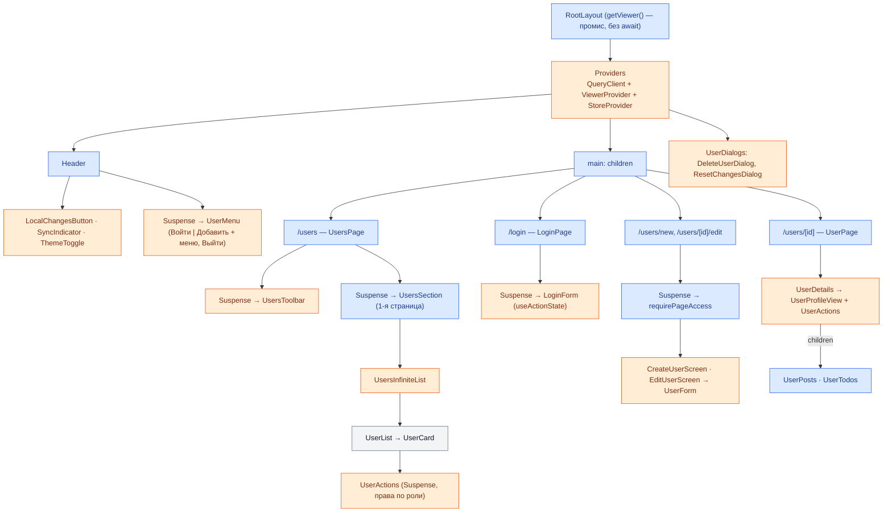

# Пользователи — ЛР №3

Лабораторная работа №3 по дисциплине «Разработка клиентских web-приложений».
Вариант 5 — предметная область **Users** ([dummyjson.com/docs/users](https://dummyjson.com/docs/users)).

Продолжение ЛР2 (Next.js 16, App Router, DummyJSON). В этой работе добавлены:

- **валидация данных через Zod** — общие схемы для формы и сервера, правило предметной области,
  проверка внешних границ (ответы DummyJSON, параметры URL, переменные окружения);
- **аутентификация через Auth.js** — вход и выход, сессия в `httpOnly` cookie переживает перезагрузку;
- **разделение прав по ролям** — гость, пользователь, модератор, администратор; проверка на сервере;
- **компонентные тесты** — Vitest, React Testing Library, user-event, покрытие `@vitest/coverage-v8`.

Отчёты по лабораторным работам лежат в папке [`reports/`](reports/).

## Возможности

- **Список** пользователей с бесконечной лентой (infinite query: автодозагрузка + кнопка «Загрузить ещё»).
- **Поиск** по имени, фамилии, логину и email, **фильтр по роли**, **сортировка**. Фильтры хранятся в URL.
- **Профиль** `/users/[id]`: данные, посты и задачи (каждая секция загружается отдельно).
- **Вход** `/login` учётной записью DummyJSON, меню пользователя с ролью и кнопкой «Выйти».
- **Добавление** `/users/new` и **изменение** `/users/[id]/edit` — отдельные страницы, доступны после входа.
- **Удаление** — только администратору: оптимистичное, с подтверждением и откатом при ошибке.
- Понятные ошибки: сообщения Zod рядом с полями, «Неверный логин или пароль», причины 401/403.
- Состояния: загрузка (скелетоны), данные, пустой результат, ошибка, повторная загрузка, отправка мутации.
- Светлая/тёмная тема без «мигания» при загрузке, адаптивная вёрстка.

## Вход и роли

Пароли тестовых записей DummyJSON публичные (есть в документации API). На странице входа их можно
подставить одной кнопкой.

| Роль | Учётная запись | Права |
| --- | --- | --- |
| гость | — | просмотр списка и профилей |
| `user` | `averyp` / `averyppass` | просмотр, добавление, изменение |
| `moderator` | `oliviaw` / `oliviawpass` | как у `user` |
| `admin` | `emilys` / `emilyspass` | всё, что у `user`, и удаление |

Матрица прав — `src/utils/permissions.ts` (`can(role, permission)`). Интерфейс по ней прячет недоступные
кнопки, а сервер проверяет права ещё раз перед каждой мутацией.

### Где проверяется доступ

| Уровень | Файл | Что делает |
| --- | --- | --- |
| Proxy | `src/proxy.ts` | удобные редиректы до рендеринга: гость с `/users/new`, `/users/[id]/edit` → `/login?callbackUrl=…`, вошедший с `/login` → обратно. **Не единственная защита** |
| Страница | `requirePageAccess` в `src/server/session.ts` | гость → `redirect('/login?callbackUrl=…')`, не хватает прав → `forbidden()` (403, `forbidden.tsx`) |
| Route Handler | `src/app/api/users/**` | сначала права, потом разбор тела: `401` — нет сессии, `403` — не та роль |
| Сервис (DAL) | `requirePermission` в `src/server/users.ts` | каждая мутация (`createUser`, `updateUser`, `deleteUser`) проверяет права сама — её вызывают и Server Functions, и Route Handlers |
| Интерфейс | `useViewer`, `UserActions`, `UserMenu` | кнопки «Добавить», «Изменить», «Удалить» видны только тем, кому разрешено |

### Сессия

Auth.js (`next-auth` v5), провайдер Credentials: логин и пароль проверяет DummyJSON (`POST /auth/login`),
роль берётся из профиля (`GET /auth/me`). Токены DummyJSON не сохраняются.

- Стратегия **JWT**: профиль (`id`, `username`, `name`, `email`, `image`, `role`) шифруется ключом `AUTH_SECRET`
  и лежит в cookie `authjs.session-token`. Срок — 7 дней.
- Cookie `httpOnly` (JavaScript её не прочитает), `sameSite=lax` (не уходит с чужих сайтов в POST-запросах),
  `secure` на HTTPS. В `localStorage` нет ни паролей, ни токенов.
- Секреты — только в серверных модулях и `.env.local`; модули с ними помечены `server-only`.
- `?callbackUrl=` проверяется схемой: разрешены только пути этого сайта (защита от open redirect).

## Валидация (Zod)

| Схема | Файл | Где используется |
| --- | --- | --- |
| `userInputSchema` | `src/schemas/user.ts` | форма (браузер), Server Functions, `POST`/`PUT` API |
| `userPatchSchema` | `src/schemas/user.ts` | `PATCH /api/users/:id` |
| `loginSchema` | `src/schemas/auth.ts` | форма входа, Server Function входа, `authorize` у Auth.js |
| `viewerSchema` | `src/schemas/auth.ts` | содержимое сессии (JWT → `session` → `getViewer`) |
| `usersApiQuerySchema`, `parseUserFilters`, `parseUserId`, `parseCallbackUrl` | `src/schemas/*` | параметры URL |
| `usersPageSchema`, `apiErrorBodySchema` | `src/schemas/user.ts` | ответы нашего API в браузере |
| `dummyUserSchema` и др. | `src/server/dummyjsonSchemas.ts` | ответы DummyJSON |
| `envSchema` | `src/server/env.ts` | переменные окружения |

Правила формы пользователя:

- имя и фамилия обязательны (до 40 символов), логин — латиница, цифры, `. _ -`, 3–20 символов, приводится
  к нижнему регистру; email — корректный адрес; возраст — целое от 1 до 120;
- телефон — цифры, пробелы, скобки, дефисы, `+` в начале; дата рождения — не в будущем и не раньше 1900 года;
- **правило предметной области:** роль «Администратор» (право удалять записи) можно назначить только
  совершеннолетнему — возраст от 18 лет. Проверка на уровне объекта (`refine` с `when`), ошибка выводится
  у поля «Возраст» вместе с остальными;
- на сервере дополнительно: уникальность логина (`409`).

Типы выводятся из схем через `z.infer` (`UserInput`, `LoginInput`, `Viewer`, `Env`, …). Утверждений `as Тип`
для внешних данных в коде нет: `response.json()` и `FormData` проходят через `safeParse`.

## Тесты

```bash
npm test               # все тесты (vitest run)
npm run test:watch     # режим наблюдения
npm run coverage       # тесты + отчёт о покрытии (в консоли и coverage/index.html)
```

Компонентные тесты проверяют поведение, которое видит пользователь: роли, тексты, подписи полей,
доступные кнопки (запросы `getByRole`, `getByLabelText`), действия — через `user-event`.

| Файл | Что проверяет |
| --- | --- |
| `components/users/UserCard.test.tsx` | отображение данных; гость не видит действий, пользователь видит «Изменить», но не «Удалить», администратор — оба |
| `components/users/UserForm.test.tsx` | сообщения Zod рядом с полями, правило «администратор от 18 лет», `onSubmit` с данными после схемы, ошибки сервера, блокировка при отправке |
| `components/users/UserActions.test.tsx` | модератор не видит удаление; администратор удаляет: подтверждение → вызов Server Function; отмена; ответ 403 |
| `components/auth/LoginForm.test.tsx` | сообщения Zod, вызов Server Function входа с `FormData`, ошибка «Неверный логин или пароль» |
| `components/layout/UserMenu.test.tsx` | «Войти» с `callbackUrl` для гостя; имя, роль, «Добавить», «Выйти» для вошедшего |
| `components/users/UserFormScreens.test.tsx` | страницы добавления/изменения: Server Function, уведомление, переход, ошибка 401 |
| `components/users/UsersInfiniteList.test.tsx` | infinite query: без дублей, конец списка, ошибка следующей страницы, пустой результат |
| `components/users/UsersToolbar.test.tsx`, `UserDetails.test.tsx` | фильтры в URL с debounce; профиль и локальные изменения |
| `server/session.test.ts`, `server/users.test.ts` | серверная проверка прав: 401/403, редирект, `forbidden()`, валидация до запроса к DummyJSON |
| `server/*`, `schemas/*`, `api/*`, `utils/*`, `stores/*` | схемы, open redirect, вход через DummyJSON, сервис, клиентский API, store |

Server Functions, роутер Next.js и сеть в компонентных тестах заменены моками и стабами (`vi.mock`,
`vi.stubGlobal('fetch', …)`). Покрытие считается для кода, который выполняется в тестах; файлы маршрутов
Next.js (`src/app/**`), `auth.ts` и `proxy.ts` проверяются сборкой (`next build`) и в браузере.

### Почему нужен клиентский store

DummyJSON только **имитирует** POST/PUT/DELETE: ответ приходит, но повторный запрос вернёт исходные данные.
Поэтому результат каждой мутации сохраняется в Zustand-store и накладывается на ответы сервера
(`src/utils/localChanges.ts`). Изменения видны в списке, в профиле и в счётчике в шапке и сохраняются
при переходах между страницами. После перезагрузки страницы они пропадают, как и в самом DummyJSON.

Другие особенности API, учтённые в коде:

- `POST /users/add` всегда отвечает `id: 209` (total + 1). Без своей нумерации у двух новых записей были бы
  одинаковые `key`, поэтому уникальный id выдаёт store.
- У созданной записи нет копии на сервере (`PUT /users/209` → 404), поэтому её изменение и удаление
  выполняются только в store. Её профиль показывает `not-found.tsx`: он находит запись в store.
- DummyJSON не умеет одновременно искать и фильтровать (`/users/search` и `/users/filter` — разные эндпоинты).
  Комбинацию «поиск + роль» сервисный слой собирает сам, клиент этой разницы не видит.

## Стек и зависимости

| Пакет | Назначение |
| --- | --- |
| `next` 16.4, `react` / `react-dom` 19.3 | App Router, Server/Client Components, Server Functions, Cache Components |
| `next-auth` 5 (Auth.js) | аутентификация, сессия в зашифрованной cookie |
| `zod` 4 | схемы валидации — общие для формы, Server Functions и Route Handlers; внешние границы |
| `@tanstack/react-query` | infinite query, клиентский кэш, состояния загрузки |
| `zustand` | store: локальные изменения и состояние интерфейса (диалоги, уведомления) |
| `server-only` | запрет импорта серверных модулей в клиентский бандл |
| `lucide-react` | иконки |
| `tailwindcss` 4, `@tailwindcss/turbopack`, `daisyui` 5 | стили |
| `vitest` 5, `@vitest/coverage-v8`, `jsdom` | тесты и покрытие |
| `@testing-library/react`, `@testing-library/user-event`, `@testing-library/jest-dom`, `@testing-library/dom` | компонентные тесты |
| `@vitejs/plugin-react`, `vite` | JSX в тестах |
| `typescript`, `@types/*`, `eslint`, `eslint-config-next` | типизация и линтинг |
| `@tanstack/react-query-devtools` | панель кэша запросов в режиме разработки |

## Запуск

```bash
npm install
cp .env.example .env.local   # и заполнить AUTH_SECRET (см. ниже)
npm run dev        # http://localhost:3000
npm run build      # production-сборка
npm start          # запуск собранного приложения
npm run lint
npm run typecheck  # next typegen + tsc
npm test
```

Переменные окружения (`.env.example`; проверяются Zod-схемой при запуске):

| Переменная | По умолчанию | Зачем |
| --- | --- | --- |
| `AUTH_SECRET` | — (обязательна) | ключ шифрования cookie сессии, не короче 32 символов: `npx auth secret` |
| `DUMMYJSON_URL` | `https://dummyjson.com` | несуществующий адрес покажет состояния ошибки |
| `DUMMYJSON_DELAY_MS` | `0` | задержка ответов API (до 5000 мс), чтобы увидеть скелетоны и индикаторы |

`.env.local` в git не попадает. Без `AUTH_SECRET` сервер не запустится и покажет понятную ошибку.

## Маршруты

| Маршрут | Рендер | Доступ | Что внутри |
| --- | --- | --- | --- |
| `/` | — | все | редирект на `/users` (`next.config.ts`) |
| `/users` | Partial Prerender | все | статическая оболочка + выдача по `searchParams` в `<Suspense>` |
| `/users/[id]` | SSG + ISR | все | первые 12 профилей при сборке (`generateStaticParams`), остальные — по запросу |
| `/users/new` | Partial Prerender | вошедшие | форма добавления; проверка сессии в `<Suspense>` |
| `/users/[id]/edit` | Partial Prerender | вошедшие | форма изменения |
| `/login` | Partial Prerender | гости | вход; вошедшего перенаправляет по `callbackUrl` |
| `/api/users` | Route Handler | `GET` — все, `POST` — вошедшие | список, создание |
| `/api/users/[id]` | Route Handler | `GET` — все, `PUT`/`PATCH` — вошедшие, `DELETE` — администратор | одна запись |
| `/api/auth/*` | Route Handler | все | служебные эндпоинты Auth.js (сессия, CSRF, вход, выход) |

## Схема компонентов

🟦 Server Component · 🟧 Client Component (`'use client'`) · ⬜ общий (без директивы и хуков,
рендерится там, куда импортирован)



Текущий пользователь передаётся клиентским компонентам через Context (`ViewerProvider`): корневой layout
не ждёт сессию, а отдаёт промис, и его читают через `use()` только компоненты внутри `<Suspense>`.
Поэтому статическая оболочка страниц не зависит от cookie, а «текущий пользователь» не протаскивается
пропсами через список и карточки.

## Слой работы с API

```
Браузер ──GET /api/users──▶ Route Handler ──┐
   │                                         ├──▶ src/server/users.ts ──▶ src/server/dummyjson.ts ──▶ DummyJSON
   └──Server Function (POST)──▶ actions.ts ──┘     (права, Zod, кэш)       (fetch + проверка ответа Zod)
Server Components (page.tsx) ────────────────┘            │
                                                          ▼
                                       src/server/session.ts ──▶ Auth.js (cookie сессии)
```

| Уровень | Файл | Ответственность |
| --- | --- | --- |
| HTTP-клиент | `src/server/dummyjson.ts` | `fetch` к DummyJSON, таймаут 10 с, проверка ответа схемой, ошибки → `ServiceError` |
| Сессия (DAL) | `src/server/session.ts` | `getViewer`, `requirePermission` (401/403), `requirePageAccess` (редирект/403) |
| Сервис | `src/server/users.ts` | бизнес-логика: права → валидация → уникальность логина → запрос; чтение с кэшем |
| Route Handlers | `src/app/api/users/**` | REST API: права, разбор параметров, HTTP-статусы, `revalidateTag` |
| Server Functions | `src/app/users/actions.ts`, `src/app/login/actions.ts` | мутации и вход из интерфейса, `updateTag`, результат `{ ok, data } \| { ok: false, status, message, fieldErrors }` |
| Клиент | `src/api/users.ts`, `src/hooks/*` | запросы к Route Handler (ответ проверяется схемой), TanStack Query, мутации + store |
| Схемы | `src/schemas/*.ts` | Zod-схемы, общие для клиента и сервера |

### REST API

| Метод | Адрес | Ответ |
| --- | --- | --- |
| GET | `/api/users?q=&role=&sort=&order=&skip=&limit=` | `200 { users, total, skip, limit }`, `400` — неверные параметры, `502` — DummyJSON недоступен |
| POST | `/api/users` | `201 User`; `401`, `400` — не JSON, `409` — логин занят, `422` — ошибки полей |
| GET | `/api/users/:id` | `200 User`, `400`, `404` |
| PUT | `/api/users/:id` | `200 User` — все поля формы; `401`, `422` |
| PATCH | `/api/users/:id` | `200 User` — только переданные поля; `401`, `422` |
| DELETE | `/api/users/:id` | `200 { id, deletedOn, isDeleted }`; `401` — гость, `403` — не администратор |

```bash
curl "http://localhost:3000/api/users?q=em&role=admin&limit=5"
curl -X DELETE http://localhost:3000/api/users/1     # 401: нет cookie сессии
```

### Кэширование

| Слой | Где | Время жизни |
| --- | --- | --- |
| Next.js server cache | `'use cache'` + `cacheLife` + `cacheTag` в `src/server/users.ts`, компонент `UsersStats` | списки — `minutes`, профиль, посты, задачи, статистика — `hours` |
| Статические страницы | `generateStaticParams`, Partial Prerendering | пересобираются по `cacheLife` (ISR) |
| Next.js client router cache | RSC-ответы посещённых и префетченных страниц | `stale` из профиля `cacheLife` |
| TanStack Query | страницы списка по ключу `['users', 'list', filters]` | `staleTime` 60 с |

В кэшируемые функции не попадает ничего, что зависит от пользователя: чтение открыто всем,
а сессия читается вне `'use cache'`. После мутации Server Function вызывает `updateTag`,
Route Handler — `revalidateTag(tag, 'max')`.

## Состояния интерфейса

| Состояние | Реализация |
| --- | --- |
| Первоначальная загрузка | `loading.tsx`, `<Suspense>` со скелетонами (список, профиль, форма, меню пользователя) |
| Данные получены | первая страница рендерится на сервере, следующие — через `useInfiniteQuery` |
| Пустой результат | `EmptyState` (нейтральное оформление, «Сбросить фильтры») |
| Ошибка | `error.tsx` сегментов, `global-error.tsx`, локальные `catchError`, ошибки запросов TanStack |
| Ошибка валидации | сообщение Zod под полем (`aria-describedby`), ошибки сервера (`409`, `422`) — там же |
| Нет доступа | редирект на вход, `forbidden.tsx`, уведомление с причиной `401`/`403` |
| Повторная загрузка при данных | `keepPreviousData` и кнопка «Обновить»: старая выдача приглушена, «Обновляем…» |
| Загрузка следующей части | плейсхолдеры-карточки в конце списка, спиннер на кнопке |
| Отправка мутации | форма заблокирована, «Сохранение…» в шапке; удаление — optimistic с откатом |

## Структура

```
src/
├── auth.ts                   # конфигурация Auth.js (Credentials, JWT, callbacks)
├── proxy.ts                  # редиректы до рендеринга (не единственная защита)
├── app/                      # маршруты App Router
│   ├── layout.tsx            # корневой layout, тема, провайдеры, промис текущего пользователя
│   ├── providers.tsx         # QueryClient + ViewerProvider + StoreProvider
│   ├── forbidden.tsx         # страница 403
│   ├── login/                # страница входа, Server Functions входа и выхода
│   ├── users/
│   │   ├── page.tsx          # список
│   │   ├── new/              # добавление
│   │   ├── actions.ts        # Server Functions мутаций
│   │   └── [id]/             # профиль; edit/ — изменение
│   └── api/                  # Route Handlers: users/**, auth/[...nextauth]
├── server/                   # server-only: env, клиент и схемы DummyJSON, сессия (DAL), сервис, ошибки
├── schemas/                  # Zod: user.ts, auth.ts
├── api/                      # клиентские запросы к Route Handlers, настройки QueryClient
├── stores/                   # Zustand: локальные изменения, интерфейс, провайдер
├── hooks/                    # useUsers, useUserFilters, useUserMutations, useLocalUser, ...
├── components/
│   ├── auth/                 # ViewerProvider (useViewer, useCan), LoginForm
│   ├── layout/               # Header, UserMenu, ThemeToggle, HeaderActions
│   ├── ui/                   # Modal, ConfirmDialog, FormField, EmptyState, ErrorState, Toast, ...
│   └── users/                # список, карточка, форма и её страницы, профиль, скелетоны
├── test/                     # фикстуры и renderWithProviders для тестов
├── types/                    # User, MutationResult, Permission, расширение типов Auth.js
├── constants/user.ts
└── utils/                    # права, форматирование, фильтры, форма, локальные изменения
```

Тесты лежат рядом с кодом: `*.test.ts(x)`.

## Инструменты отладки (режим разработки)

- **Next.js DevTools** — круглая кнопка «N» в левом нижнем углу: маршруты, ошибки, Navigation Inspector.
- **TanStack Query Devtools** — кнопка правее «N»: кэш запросов и страницы infinite query.
- **Redux DevTools** (расширение браузера) — история действий Zustand-store'ов (`users-store`, `ui-store`).

Обе кнопки есть только в режиме разработки (`npm run dev`), в production-сборке их нет.
