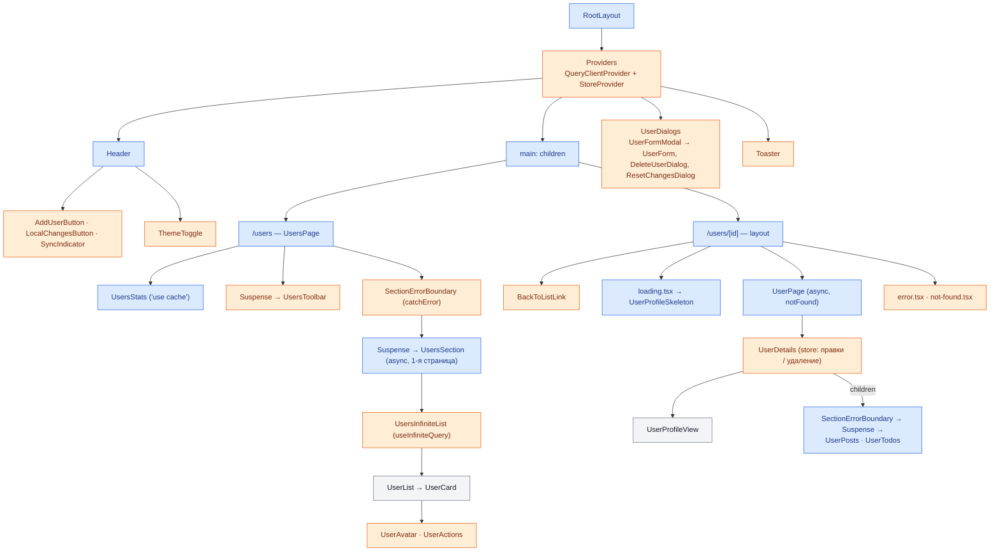

# Пользователи — ЛР №2

Лабораторная работа №2 по дисциплине «Разработка клиентских web-приложений».
Вариант 5 — предметная область **Users** ([dummyjson.com/docs/users](https://dummyjson.com/docs/users)).

Продолжение ЛР1: приложение перенесено с Vite на **Next.js 16 (App Router)**, данные загружаются
из DummyJSON API вместо локального массива.

Отчёты по лабораторным работам лежат в папке [`reports/`](reports/).

## Возможности

- **Список** пользователей с бесконечной лентой (infinite query: автодозагрузка + кнопка «Загрузить ещё»).
- **Поиск** по имени, фамилии, логину и email, **фильтр по роли**, **сортировка**. Фильтры хранятся в URL, ссылкой можно поделиться.
- **Страница пользователя** `/users/[id]`: профиль, посты и задачи (каждая секция загружается отдельно).
- **Добавление, изменение, удаление** через Server Functions. Удаление оптимистичное, с откатом при ошибке.
- Отдельные состояния: первоначальная загрузка (скелетоны), данные, пустой результат, ошибка, повторная загрузка
  при показанных данных, загрузка следующей страницы, отправка мутации.
- Светлая/тёмная тема без «мигания» при загрузке, адаптивная вёрстка.

### Почему нужен клиентский store

DummyJSON только **имитирует** POST/PUT/DELETE: ответ приходит, но повторный запрос вернёт исходные данные.
Поэтому результат каждой мутации сохраняется в Zustand-store и накладывается на ответы сервера
(`src/utils/localChanges.ts`). Изменения видны в списке, в профиле и в счётчике в шапке и сохраняются
при переходах между страницами. После перезагрузки страницы они пропадают, как и в самом DummyJSON.

Другие особенности API, учтённые в коде:

- `POST /users/add` всегда отвечает `id: 209` (total + 1). Без своей нумерации у двух новых записей были бы
  одинаковые `key`, поэтому уникальный id выдаёт store.
- У созданной записи нет копии на сервере (`PUT /users/209` → 404), поэтому её изменение и удаление
  выполняются только в store. Её профиль показывает `not-found.tsx`: он находит запись в store.
- DummyJSON не умеет одновременно искать и фильтровать (`/users/search` и `/users/filter` — разные эндпоинты).
  Комбинацию «поиск + роль» сервисный слой собирает сам, клиент этой разницы не видит.

## Стек и зависимости

| Пакет | Назначение |
| --- | --- |
| `next` 16.4, `react` / `react-dom` 19.3 | App Router, Server/Client Components, Server Functions, Cache Components |
| `@tanstack/react-query` | infinite query, клиентский кэш, состояния загрузки |
| `zustand` | store: локальные изменения и состояние интерфейса (диалоги, уведомления) |
| `zod` | схемы валидации — общие для формы, Server Functions и Route Handlers |
| `server-only` | запрет импорта серверных модулей в клиентский бандл |
| `lucide-react` | иконки |
| `tailwindcss` 4, `@tailwindcss/turbopack`, `daisyui` 5 | стили (как в ЛР1) |
| `typescript`, `eslint`, `eslint-config-next` | типизация и линтинг |
| `@tanstack/react-query-devtools` | панель кэша запросов в режиме разработки |

## Запуск

```bash
npm install
npm run dev        # http://localhost:3000
npm run build      # production-сборка
npm start          # запуск собранного приложения
npm run lint
npm run typecheck  # next typegen + tsc
```

Переменные окружения (необязательно, см. `.env.example`):

| Переменная | По умолчанию | Зачем |
| --- | --- | --- |
| `DUMMYJSON_URL` | `https://dummyjson.com` | несуществующий адрес покажет состояния ошибки |
| `DUMMYJSON_DELAY_MS` | `0` | задержка ответов API (до 5000 мс), чтобы увидеть скелетоны и индикаторы |

```bash
# PowerShell
$env:DUMMYJSON_DELAY_MS=1500; npm run dev
# bash
DUMMYJSON_DELAY_MS=1500 npm run dev
```

## Маршруты

| Маршрут | Рендер | Что внутри |
| --- | --- | --- |
| `/` | — | редирект на `/users` (`next.config.ts`) |
| `/users` | Partial Prerender | статическая оболочка + выдача по `searchParams`, которая стримится в `<Suspense>` |
| `/users/[id]` | SSG + ISR | первые 12 профилей генерируются при сборке (`generateStaticParams`), остальные — при первом запросе |
| `/api/users` | Route Handler | `GET` (список), `POST` (создание) |
| `/api/users/[id]` | Route Handler | `GET`, `PUT`, `PATCH`, `DELETE` |

## Схема компонентов

🟦 Server Component · 🟧 Client Component (`'use client'`) · ⬜ общий (без директивы и хуков,
рендерится там, куда импортирован)



Принцип: всё, что не требует состояния, событий или браузерных API, остаётся на сервере.
Client Components — небольшие «острова» интерактивности. Server Components передаются в клиентские
через `children` (`UserDetails`, `Providers`): клиент получает готовый результат их рендера,
а их код в клиентский бандл не попадает.

## Слой работы с API

```
Браузер ──GET /api/users──▶ Route Handler ──┐
   │                                         ├──▶ src/server/users.ts ──▶ src/server/dummyjson.ts ──▶ DummyJSON
   └──Server Function (POST)──▶ actions.ts ──┘        (сервис, 'use cache')     (fetch, таймаут, ошибки)
Server Components (page.tsx) ────────────────┘
```

| Уровень | Файл | Ответственность |
| --- | --- | --- |
| HTTP-клиент | `src/server/dummyjson.ts` | `fetch` к DummyJSON, таймаут 10 с, `?delay=`, ошибки → `ServiceError` со статусом |
| Сервис | `src/server/users.ts` | вся бизнес-логика: чтение с кэшем, валидация zod, уникальность логина, приведение ответа к `User` |
| Route Handlers | `src/app/api/users/**` | REST API: разбор параметров, HTTP-статусы, `revalidateTag` |
| Server Functions | `src/app/users/actions.ts` | мутации из интерфейса, `updateTag`, результат `{ ok, data } \| { ok: false, message, fieldErrors }` |
| Клиент | `src/api/users.ts`, `src/hooks/useUsers.ts`, `src/hooks/useUserMutations.ts` | запросы к Route Handler, ключи TanStack Query, мутации + store + уведомления |
| Схемы | `src/schemas/user.ts` | zod-схемы, общие для клиента и сервера |

`server-only` в серверных модулях гарантирует, что они не попадут в клиентский бандл:
импорт из Client Component сломает сборку.

### REST API

| Метод | Адрес | Ответ |
| --- | --- | --- |
| GET | `/api/users?q=&role=&sort=&order=&skip=&limit=` | `200 { users, total, skip, limit }`, `400` — неверные параметры, `502` — DummyJSON недоступен |
| POST | `/api/users` | `201 User`, `400` — не JSON, `409` — логин занят, `422` — ошибки полей |
| GET | `/api/users/:id` | `200 User`, `400`, `404` |
| PUT | `/api/users/:id` | `200 User` — все поля формы |
| PATCH | `/api/users/:id` | `200 User` — только переданные поля |
| DELETE | `/api/users/:id` | `200 { id, deletedOn, isDeleted }` |

```bash
curl "http://localhost:3000/api/users?q=em&role=admin&limit=5"
curl -X PATCH http://localhost:3000/api/users/1 -H "Content-Type: application/json" -d "{\"age\": 30}"
```

### Кэширование

| Слой | Где | Время жизни |
| --- | --- | --- |
| Next.js server cache | `'use cache'` + `cacheLife` + `cacheTag` в `src/server/users.ts`, компонент `UsersStats` | списки — `minutes`, профиль, посты, задачи, статистика — `hours` |
| Статические страницы | `generateStaticParams`, Partial Prerendering | пересобираются по `cacheLife` (ISR) |
| Next.js client router cache | RSC-ответы посещённых и префетченных страниц | `stale` из профиля `cacheLife` |
| TanStack Query | страницы списка по ключу `['users', 'list', filters]` | `staleTime` 60 с |

После мутации Server Function вызывает `updateTag` (read-your-own-writes), Route Handler — `revalidateTag(tag, 'max')`.

## Состояния интерфейса

| Состояние | Реализация |
| --- | --- |
| Первоначальная загрузка | `loading.tsx` профиля, `<Suspense>` со скелетонами на списке |
| Данные получены | первая страница рендерится на сервере, следующие — через `useInfiniteQuery` |
| Пустой результат | `EmptyState` (нейтральное оформление, «Сбросить фильтры») |
| Ошибка | `error.tsx` сегментов, `global-error.tsx`, локальные `catchError` для секций, ошибки запросов TanStack |
| Повторная загрузка при данных | `keepPreviousData` при смене фильтров и кнопка «Обновить»: старая выдача приглушена, индикатор «Обновляем…» |
| Загрузка следующей части | плейсхолдеры-карточки в конце списка, спиннер на кнопке |
| Отправка мутации | форма заблокирована, окно не закрывается, «Сохранение…» в шапке; удаление — optimistic с откатом |

## Структура

```
src/
├── app/                      # маршруты App Router
│   ├── layout.tsx            # корневой layout, скрипт темы, провайдеры
│   ├── providers.tsx         # QueryClientProvider + StoreProvider
│   ├── users/
│   │   ├── page.tsx          # список
│   │   ├── error.tsx
│   │   ├── actions.ts        # Server Functions
│   │   └── [id]/             # layout, page, loading, error, not-found
│   └── api/users/            # Route Handlers
├── server/                   # server-only: клиент DummyJSON, сервис, ошибки
├── api/users.ts              # клиентские запросы к Route Handlers
├── stores/                   # Zustand: локальные изменения, интерфейс, провайдер
├── hooks/                    # useUsers, useUserFilters, useUserMutations, useLocalUser, ...
├── components/
│   ├── layout/               # Header, ThemeToggle, HeaderActions
│   ├── ui/                   # Modal, ConfirmDialog, FormField, EmptyState, ErrorState, Toast, SectionErrorBoundary
│   └── users/                # список, карточка, форма, профиль, посты, задачи, скелетоны
├── schemas/user.ts           # zod-схемы
├── types/                    # User, UsersPage, MutationResult, ...
├── constants/user.ts
└── utils/                    # форматирование, фильтры, форма, наложение локальных изменений
```

## Инструменты отладки (режим разработки)

- **Next.js DevTools** — круглая кнопка «N» в левом нижнем углу: маршруты, ошибки, Navigation Inspector
  (статическая оболочка и fallback-состояния при переходах).
- **TanStack Query Devtools** — кнопка правее «N»: кэш запросов и страницы infinite query.
- **Redux DevTools** (расширение браузера) — история действий Zustand-store'ов (`users-store`, `ui-store`).

Обе кнопки есть только в режиме разработки (`npm run dev`), в production-сборке их нет.
